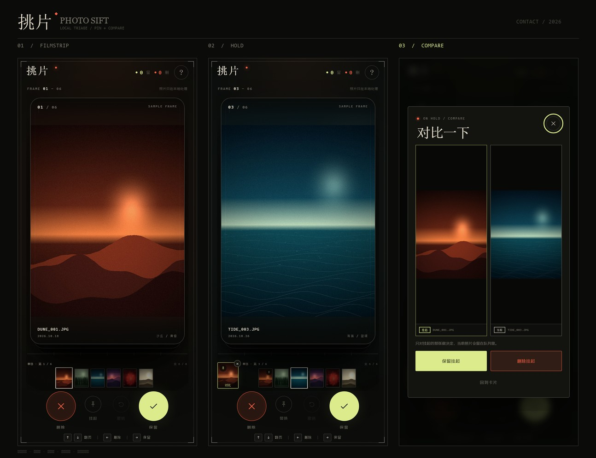
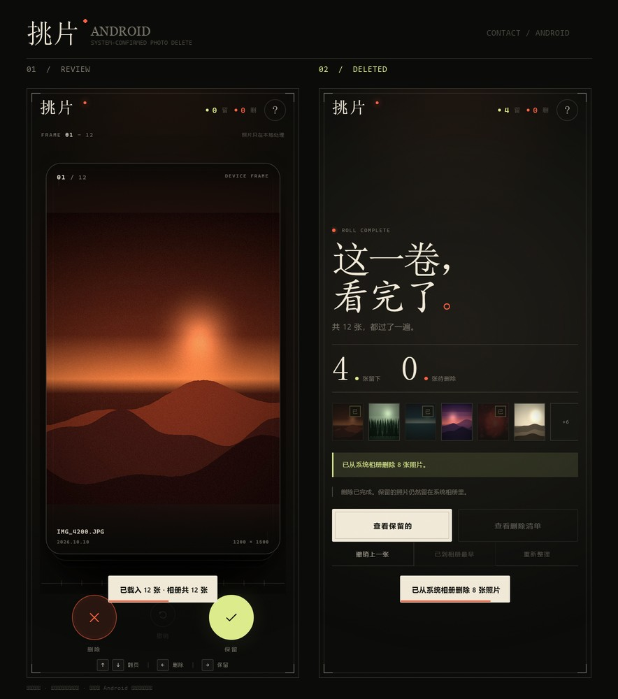

# 挑片 / Photo Sift

一个手机优先的本地照片整理工具：上下翻页，左滑标记删除，右滑保留；支持把一张照片挂起、继续翻看后并排对比。

项目包含两个版本：

- **网页版**：零依赖静态页面，照片只在浏览器本地读取，适合快速体验和部署。
- **Android 原生版**：通过系统相册权限和 `MediaStore` 真正删除手机里的照片；删除前由 Android 系统再次确认。





## 功能

- 手机相册读取 / 多选导入
- 上下滑动翻页
- 左滑加入删除清单，右滑保留
- **挂起对比**：把一张照片停靠在底部，继续翻看几张后并排比较，再决定挂起那张的去留
- **连拍预览条**：显示前后照片、连续拍摄分组和组内剩余张数，方便判断一组连拍什么时候翻完
- 撤销上一张决定
- 保留 / 待删除清单，可导出删除清单
- Android 原生版支持在整理过程中随时批量删除
- 原生删除通过 Android `MediaStore.createDeleteRequest` 执行，系统确认后永久删除
- 无构建依赖的网页版；Android 版使用 Capacitor 8 + 自定义原生插件

## 网页版

在线体验：<https://yuuuuub.github.io/photo-sift/photo-triage/>

也可以直接打开 [`photo-triage/index.html`](photo-triage/index.html)，或启动静态服务器：

```bash
cd photo-triage
python -m http.server 8000
```

打开 <http://localhost:8000>。

> 浏览器没有权限直接删除系统相册，所以网页版的左滑只是**标记**，结果页会生成待删除清单，需要手动去系统相册清理。

详见 [网页版说明](photo-triage/README.md)。

## Android 原生版

安装包：[`photo-triage-native/photo-triage-release.apk`](photo-triage-native/photo-triage-release.apk)（约 7.9 MB，Android 11+，release 签名，可覆盖升级）

调试包：[`photo-triage-native/photo-triage-debug.apk`](photo-triage-native/photo-triage-debug.apk)（仅开发用，签名不同，不能与 release 版互相覆盖）

首次打开会自动请求相册权限。左滑标记后，可以：

- 随时点右上角「删除已选 N」，立即批量删除；
- 或在结果页点「从系统相册删除 N 张」。

Android 会弹出一次系统确认；确认后照片被永久删除，无法撤销。

> release 包用项目自带的 keystore 签名，适合自用 / 侧载。上架 Google Play 需申报照片和视频权限用途，见 [签名说明](photo-triage-native/SIGNING.md)。

构建说明、权限声明、原生实现见 [Android 版说明](photo-triage-native/README.md)。

照片处理与数据流向见 [隐私说明](PRIVACY.md)。

## 目录

```text
.
├── photo-triage/             # 静态网页版
│   ├── index.html
│   ├── styles.css
│   ├── app.js
│   ├── demo/
│   └── preview.jpg
└── photo-triage-native/      # Capacitor Android 工程
    ├── www/                  # WebView 资源
    ├── android/              # Android 工程
    ├── native-entry.js       # Capacitor 插件打包入口
    ├── photo-triage-debug.apk
    └── preview.jpg
```

## 构建 Android APK

需要 Node.js 22+、JDK 21、Android SDK 36：

```bash
cd photo-triage-native
npm install
npm run sync
npm run build:apk
```

生成：

```text
android/app/build/outputs/apk/debug/app-debug.apk
```

也可以运行 `npm run open:android` 用 Android Studio 打开。

## 隐私

- 照片在设备本地读取，不上传服务器；
- 网页版无网络请求、无账号、无统计；
- Android 版缩略图只缓存在应用自己的 cache 目录；
- 删除操作由 Android 系统确认弹窗控制。

## License

MIT
