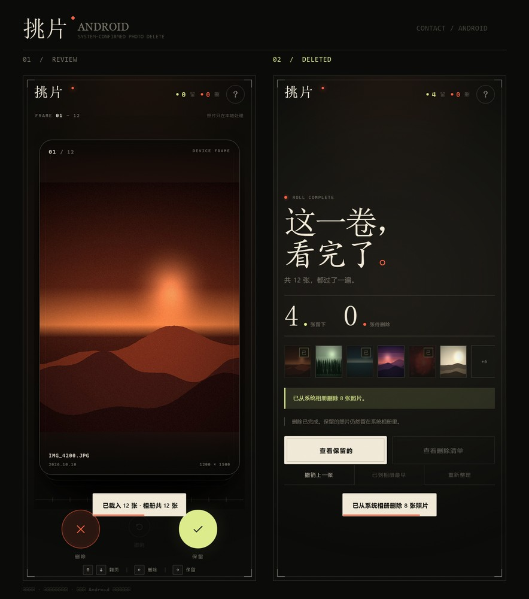

# 挑片 Android

基于现有「挑片」网页封装的 Android 原生应用。它复用同一套卡片交互，并通过 Android `MediaStore` 真正删除系统相册里的照片。



> 删除不会静默执行。点「从系统相册删除」后，Android 会弹出系统级确认窗口；只有你确认后，照片才会被永久删除。

## Android 版本要求

- **Android 11（API 30）及以上**
- Android 11+ 的批量媒体删除必须走系统 `MediaStore.createDeleteRequest`，因此不能更低版本上可靠地执行真实删除。

## 已实现

- 启动时检查并请求「照片和视频」访问权限
- 从系统相册读取 **最近 60 张** 照片，生成 1080px 预览
- 上/下滑翻页，左滑加入待删除，右滑保留
- 点「挂起」把当前照片放到预览条左侧，继续翻看后与当前照片并排对比，再决定挂起那张的去留
- 底部连拍预览条显示前后照片、连拍分组、组内剩余张数，并可点击跳转
- 双击照片全屏放大，双指捏合缩放（1×–6×）、拖动查看细节（边角 / 焦点是否清晰）
- 真正删除前会先弹一次 App 内确认：列出即将删除的缩略图，看过一遍再交给系统确认
- **相似照片**：先读取相册总数，选范围后自动把连拍/同一场景的照片聚成组，每组保留最清晰的一张，其余可一键标记删除
  - 组内每张缩略图右下角有放大按钮，可放大对比、拖动看细节，还能用 ← → 在组内切换；放大页可直接「设为保留」
  - 放大页支持双指捏合缩放（1×–6×）
  - 每组右上角可「整组删除」，把整组（含建议保留那张）一起标记删除，再点一次「恢复保留」可撤销
- 浏览过程中随时可点右上角「删除已选 N」立即批量删除，不必先看完
- 完成一批后可继续加载更早的照片
- 结果页提供「从系统相册删除 N 张」按钮
- 一次整理完成后，通过系统弹窗批量删除，不需要逐张手动确认
- 删除完成后，App 内同步更新计数和结果页
- 权限被拒绝时提供「打开系统设置」
- Android 返回键：返回上一张，或退出

## 直接安装 APK

已经构建并验证过签名的调试包：

```text
photo-triage-debug.apk
```

- 大小：约 9.6 MB
- 包名：`com.tiaopian.app`
- 版本：1.0（versionCode 1）
- 最低系统：Android 11（API 30）
- 签名：Android Debug（v2 签名，可安装）
- SHA-256：

```text
A59659DC533B2D225E18923EE614555CEA6F2C10DB26D58D2FD036ED8ADCAE38
```

安装方式：把 APK 发到手机，允许「安装未知来源应用」，点击安装；或连接 USB 调试后执行：

```bash
adb install -r photo-triage-debug.apk
```

> 这是 debug 签名包，适合自用 / 侧载。若要上架或长期分发，请用你自己的 release keystore 重新签名。

## 构建环境

已验证构建环境：

- Windows
- Node.js 22+
- JDK 21
- Android SDK Platform 36、Build Tools 35.0.0 / 36.0.0
- Capacitor 8
- Gradle 8.14.3

环境变量示例（Windows PowerShell）：

```powershell
$env:JAVA_HOME = "C:\Users\你的用户名\java\jdk-21.0.13+9"
$env:ANDROID_HOME = "C:\Users\你的用户名\Android\Sdk"
$env:ANDROID_SDK_ROOT = $env:ANDROID_HOME
$env:Path = "$env:JAVA_HOME\bin;$env:ANDROID_HOME\platform-tools;$env:Path"
```

## 构建 APK

```bash
cd photo-triage-native
npm install
npm run sync
npm run build:apk
```

生成文件：

```text
android/app/build/outputs/apk/debug/app-debug.apk
```

安装到已开启 USB 调试的手机：

```bash
adb install -r android/app/build/outputs/apk/debug/app-debug.apk
```

也可以直接用 Android Studio：

```bash
npm run open:android
```

> 如果 Gradle Wrapper 下载很慢，可以改用 Android Studio 自带的 Gradle，或把 `android/gradle/wrapper/gradle-wrapper.properties` 的下载地址换成本地 / 镜像地址。普通网络环境下使用官方地址即可。
>
> 国内网络如果 Maven 依赖下载停滞，可临时在 `android/build.gradle` 的 `buildscript.repositories` 和 `allprojects.repositories` 最前面加入 `maven { url 'https://maven.aliyun.com/repository/google' }` 与 `maven { url 'https://maven.aliyun.com/repository/public' }`；官方仓库保留在最后作为回退。

## 目录结构

```text
photo-triage-native/
├── www/                     # Capacitor WebView 资源
│   ├── index.html
│   ├── styles.css
│   ├── app.js              # 包含原生相册/删除流程
│   ├── features.js         # 挂起对比、连拍预览条
│   ├── zoom.js             # 双击放大
│   ├── similar.js          # 相似照片分组（感知哈希）
│   └── native-bundle.js    # Capacitor 插件 JS 打包产物
├── native-entry.js         # 打包入口：@capacitor/core、App、PhotoLibrary、PhotoDeleter
├── capacitor.config.json
├── photo-triage-debug.apk  # 已构建的调试 APK
├── preview.jpg             # 原生界面预览
├── android/
│   ├── app/src/main/java/com/tiaopian/app/
│   │   ├── MainActivity.java
│   │   └── PhotoDeleterPlugin.java
│   └── ...
├── resources/icon-1024.png # 应用图标源文件
├── package.json
└── README.md
```

## 原生实现说明

### 读取相册

使用 [`@capgo/capacitor-photo-library`](https://capgo.app/docs/plugins/photo-library/)：

- `checkAuthorization()` / `requestAuthorization()`
- `getLibrary({ offset, limit, includeImages: true, includeVideos: false })`
- 返回每张照片的缩略图路径和 `image:<MediaStoreId>` 标识
- 预览图缓存在 App 的 cache 目录

### 删除

自定义本地 Capacitor 插件 `PhotoDeleter`：

- JS 侧传入 `{ ids: ["image:123", ...] }`
- 原生侧解析为 `content://media/external/images/media/123`
- 使用 `MediaStore.createDeleteRequest(...)` 生成系统确认 `PendingIntent`
- 通过 `ActivityResultContracts.StartIntentSenderForResult` 等待用户确认
- 用户确认后返回 `{ deleted: true, ids }`
- 用户取消则返回 `{ deleted: false, canceled: true }`

`PhotoDeleterPlugin` 注册在 `MainActivity.onCreate()` 中。

### 权限

`AndroidManifest.xml` 声明：

- `READ_MEDIA_IMAGES`（Android 13+）
- `READ_MEDIA_VIDEO`（相册插件会一并请求，实际只展示图片）
- `READ_MEDIA_VISUAL_USER_SELECTED`（Android 14 受限访问）
- `READ_EXTERNAL_STORAGE`（API 30–32，`maxSdkVersion=32`）

首次打开时自动请求权限。若被拒绝，在 intro 页点「打开系统设置」重新授权。

## 挂起对比与连拍预览条

- **挂起**：点底部「挂起」，当前照片停靠在预览条左侧；继续翻几张，点小卡即可和当前照片并排对比。
- **连拍分组**：相邻照片时间差在 2.5 秒内归为同一组，预览条会显示「连拍 N 张 / 本组还剩 N 张」。
- 挂起照片仍然留在队列中，最终需要做一次保留 / 删除决定；对比面板只决定挂起的那一张。

## 说明与限制

- **删除必须由系统确认**，这是 Android 的安全要求，原生 App 也不能静默删除。
- 一次最多批量删除 2000 张；App 当前每批加载 60 张，正常使用不会触及上限。
- 预览图是 1080px，足以在手机上判断照片，但不是原图。原图不会被上传或转存。
- 仅列出设备本地的照片（`includeCloudData: false`），避免对云端照片执行删除时出现不一致。
- Android 14 的「仅允许访问部分照片」会按系统允许的范围读取；App 会提示当前是受限访问模式。
- 当前工程只包含 Android。iOS 需要额外的 PhotoKit 实现，且必须在 macOS 上构建签名。
- 正式上架 Google Play 前，需要根据 Play 的「照片和视频权限」政策填写权限声明；个人侧载 / 自用安装不受该上架流程影响。

## 验证状态

- 已用 Capacitor 8 + JDK 21 + Android SDK 36 完整编译成功。
- APK 已通过 `apksigner verify`（v2 签名有效）。
- 已确认 `PhotoDeleterPlugin` 和 `MainActivity` 被编译进 dex。
- 已确认 APK 内资源包含最终 HTML/CSS/JS。
- 原生相册读取和系统删除弹窗属于设备能力，当前构建机没有连接 Android 真机 / 模拟器，因此未做真机点击删除验证；安装后第一次运行会请求相册权限，建议先用自己的 1–2 张测试照片走一遍。


## 隐私

- 图片通过 Android MediaStore 读取，不经过服务器；
- App 没有网络上传逻辑；
- 缩略图只缓存在 App 自己的 cache 目录；
- 删除操作完全由系统确认弹窗控制。
