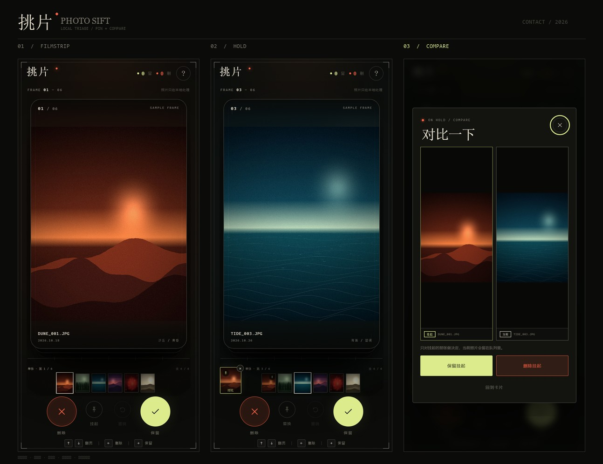

# 挑片 / Photo Sift

一个手机优先的本地照片整理页：一次选入多张照片，上下翻页查看，左滑标记删除，右滑保留；还可以把一张照片「挂起」到边上，继续翻看后并排对比。



不需要安装依赖，也没有构建步骤。照片只在浏览器内读取，不会上传。

> 如果你需要**真正从手机系统相册删除**照片，而不是只做清单标记，请使用 Android 原生版：[`../photo-triage-native`](../photo-triage-native/README.md)。

## 直接使用

**电脑上快速预览：** 双击 `index.html`，或在本目录启动一个静态服务器：

```bash
cd photo-triage
python -m http.server 8000
```

然后打开 <http://localhost:8000>。

**在手机上使用：** 把整个 `photo-triage` 文件夹部署到任意静态托管（GitHub Pages、Netlify、Vercel、对象存储等），或者让电脑和手机连同一个 Wi-Fi，在电脑上执行：

```bash
python -m http.server 8000
```

再用手机浏览器访问 `http://电脑的局域网IP:8000`。

> 通过 `http://局域网IP` 访问时，文件选择、相册读取可以正常使用。若部署到线上，建议使用 HTTPS。

首次打开可以先点「先看示例」体验完整手势流程，再返回刷新页面选择自己的照片。

## 手势与快捷键

| 操作 | 手机 | 桌面 |
| --- | --- | --- |
| 翻到下一张 / 上一张 | 上滑 / 下滑 | `↑` / `↓`，或鼠标拖动 |
| 标记删除 | 左滑 | `←`，或点「删除」 |
| 保留 | 右滑 | `→`，或点「保留」 |
| 放大看细节 | 双击照片 | 双击照片、`F` 或回车 |
| 挂起当前照片 | 点「挂起」 | `P`，或点「挂起」 |
| 并排对比挂起照片 | 点预览条左侧的小卡 | `C`，或点预览条左侧的小卡 |
| 撤销上一次决定 | 点「撤销」或提示条里的撤销 | `Z` / `Ctrl+Z` / `Cmd+Z` |
| 重新选择照片 | 刷新页面；结果页的「再选一些」会把新照片追加到当前整理 | `O` |

结果页可以查看保留清单、删除清单，并把删除清单导出为 `.txt`。

## 挂起对比与连拍预览条

- **挂起**：点底部的「挂起」，当前照片会停靠在底部预览条左侧。继续往下翻几张，再点那张小卡，就能和当前照片并排对比；对比面板里只决定挂起的那一张。
- **连拍预览条**：底部会显示当前照片前后的缩略图。相邻照片时间差在 2.5 秒内会归为同一组连拍，组与组之间用分隔线隔开，并显示「连拍 N 张 / 本组还剩 N 张」。
- 预览条上的缩略图可以点击，跳回对应的待整理照片；已经保留或标记删除的照片会显示对应状态。
- 挂起的照片仍然留在队列里，需要最终做一次保留 / 删除决定。

## 关于「删除」的边界

浏览器的安全模型不允许网页直接删除手机系统相册里的照片。

因此这里的「删除」是**整理清单里的标记**，不是物理删除：

- 左滑后，照片会从当前卡片队列移出，并进入「待删除」清单；
- 你可以在结果页查看清单、导出文件名列表；
- 最后需要打开系统相册，按清单手动删除照片。

这样设计也避免了网页误删原图。页面不会上传、转存或修改原文件。

## 隐私与状态

- 所有图片通过 `<input type="file">` 在本地读取，使用 `URL.createObjectURL()` 渲染；
- 没有网络请求、没有账号、没有统计脚本；
- 刷新页面后，本次整理状态会清空；
- 演示图片是项目内生成的抽象画面，不是外部图库照片。

## 文件结构

```text
photo-triage/
├── index.html        # 页面结构
├── styles.css        # 视觉、响应式布局、动效
├── app.js            # 文件读取、手势、状态、结果导出
├── features.js       # 挂起对比、连拍预览条
├── zoom.js           # 双击放大、捏合缩放、拖动查看
├── demo/             # 示例照片（01–06）
├── preview.jpg       # 界面预览拼图
└── README.md
```

## 自定义

主要视觉变量集中在 `styles.css` 的 `:root`：

```css
--bg: #0b0c0a;
--paper: #f1e9d8;
--red: #ff6041;
--lime: #dceb8b;
```

字体使用系统自带的宋体 / Georgia / Avenir Next / 等宽字体组合，不依赖 Google Fonts，断网也能保持完整样式。

## 兼容性

已在 Chromium 156 的无头浏览器中验证：

- 390 × 844（主流手机竖屏）
- 320 × 568（小屏手机）
- 844 × 390（手机横屏）
- 1024 × 768、1280 × 800（平板 / 桌面）
- 触摸滑动、鼠标拖动、键盘操作、撤销、结果弹窗与文件选择流程

建议使用较新的 Chrome、Edge、Safari 或 Firefox。HEIC 等格式能否预览取决于浏览器和系统；无法预览时卡片会显示提示，但仍可保留或标记删除。
